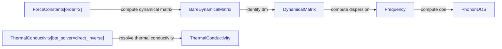

<p align="center"></p>

# openmaterials-ai

[](https://openmaterials.ai/)


OpenMaterials is a versioned, content-addressed map of physics. Physical
quantities are typed nodes, and operators that carry symbolic (sympy) formulas
connect them. Each external code (kALDo, phono3py, phonopy, ShengBTE, LAMMPS,
GPUMD, and others) has a *representation*: a mapping of its numerical output
onto the shared nodes, with units and conventions. Because every quantity is
typed and every formula is executable, the kernel can evaluate the formulas on
numerical arrays and cross-check two inputs at a gauge-invariant observable
(examples/quickstart.py does both). The resolver (omai/semantics.py, with labels
in docs/data/semantics.json) maps a method name as a paper or a language model
writes it, such as "quasi-harmonic approximation", to typed, content-addressed
node ids. An agent that resolves a phrase this way gets the node's formula, its
Lean dimension and any compiled formula proof, the codes that produce it with their
citations, and the values attached to it with their provenance. OpenMaterials is
stewarded by OpenMaterials-AI, a foundation in formation.

At map version 98da97c6d855 the map has 136 typed quantities (122 observable, 11
hidden, 3 parameter), 308 links (266 formula, 42 parameter), and 133 operators
in 18 tiers. It holds representations for 33 codes and 90 committed values (84
from simulations, 6 from measurements). The [codes
bibliography](https://openmaterials.ai/codes/) lists each code with its
interface, citation, and license. Browse it in 2D at
[openmaterials.ai/map/](https://openmaterials.ai/map/) or in 3D at
[openmaterials.ai/map-3d/](https://openmaterials.ai/map-3d/). The full
specification (vision, product, architecture, kernel, status, and the procedures
for ingesting a code, extending the DAG, and encoding a catalog skill) is
[docs/openmaterials.pdf](docs/openmaterials.pdf), with its LaTeX source
alongside. The same document is readable as HTML at
[openmaterials.ai/document/](https://openmaterials.ai/document/);
`PYTHONPATH=. python -m omai.doc_html` generates that page from the LaTeX
source.

The database is plain files in this repository. The versioned map lives in
`map/`, an append-only log of content-addressed records. The site reads the
generated files under `docs/data/`: `graph.json` (quantities and formulas),
`catalog.json` (symbol, dimension, and description per node), `codes.json` (each
code's representation), `instances/` (one file per value), `configurations/`
(one file per atomic structure, the content-addressed home of a `Structure`
value, bundled into `configurations.json`), `models/` (one file per model a code
reads, such as an interatomic potential: its uid, the sha256 of its files, its
license and citation; the files themselves stay upstream), and `releases/` (one
file per representation with registered releases: each release's version, tag,
commit, date, and the license read at that tag). Rebuild the generated files
with:

```bash
CUDA_VISIBLE_DEVICES="" PYTHONPATH=. python -m omai.map_data
```

To add a value, put a JSON file under `docs/data/instances/` and open a pull
request. Contributors keep their rights: adding a value grants the initiative a
non-exclusive license to redistribute it under CC BY 4.0, and the raw simulation
or experimental artifacts behind it are never ingested (GOVERNANCE.md, "Data
ownership and fairness").

## Share a result with a link

OpenMaterials provides templates and lineages; MaterialsCodeGraph stores
experiments and runs simulations from lineages.

Glossary:

- THE LINEAGE (the schema) is one versioned artifact holding the derivation
  graph and the instance-format rules, published as `docs/data/lineage.json`
  with an append-only version chain in `docs/data/versions.json`. Its rolling
  `lineage_version` is a content hash over both halves; the six gates are its
  amendment process; the map is its visualization.
- A lineage (an instance) is the shareable run record defined in
  `omai/lineages.py`: a pinned path through the artifact, identified by the
  hash of its `lineage` object alone.
- Source is a lineage's namespaced origin, a `scheme:ref` string inside the
  hash (`paper:...`, `doi:...`, `zotero:...`, `arxiv:...`): identity-bearing,
  so the same claim from the same source mints the same id while one paper's
  several results stay distinct records. Legacy top-level `source` objects on
  old records ride outside the hash forever and never re-mint an id.
- Provenance is a quantity instance's source reference, `source.ref`.
- Derivation is a node's upstream graph in the map.

A lineage can be shared as a link on its own, with no store or server. The
record is light and lineage-identified: its identity comes from its `lineage`
field (a map node when known, else a template with its hyperparameters and setup
values), and heavy artifacts are optional pointers to wherever the bytes are
kept, for example [MaterialsCodeGraph](https://materialscodegraph.com/), never
embedded. Because it is light, the whole record gzips into a `#x=` link fragment
that opens in the playground's Lineage tab:

```
https://openmaterials.ai/play/#/play?tab=lineage&x=<gzipped record>
```

A committed value also has a canonical permalink, `/l/<lineage id>`, resolved
at the edge by the site Worker (`infra/site`: the same `docs/` served as
Cloudflare assets plus the dynamic routes; everything else is static
fallthrough, so the Worker is additive over the static site). The permalink
unfurls with the value's own Open Graph card and redirects to the playground
datasheet. An uncommitted bundle can be stored for a short link instead:
`Copy short link` on the bundle view mints `<site>/s/<code>` (a public,
rate-limited KV store on the Worker), which unfurls from the stored envelope
and reopens the full datasheet page anywhere, with no URL-length limit.

Opening the link renders straight into a **full-width, dense, plain datasheet**:
a lineage is a data container, and OpenMaterials (the static site) is the
container's viewer, so the view shows the information the record holds, plainly,
not a dashboard. Opening the Lineage tab without a record loads the committed
Si diamond thermal conductivity value `f735a05c14db` (147 W/(m K), kALDo direct
inversion) into the same datasheet, with plain links to the listed examples in
`docs/examples/index.json`. It
presents what the record is (the kind, simulation or measurement, the output map
node, the material, and the short lineage id), the lineage's every field as plain
labelled key-values and a simple value-and-units table (node, node_uid, material
and its pinned configuration, template, all hyperparameters, conditions, params,
and the execution: code, version, container digest, runner, wall time, seeds),
what it means on the map (the node's plain-language description, units, and map
tier pulled from the catalog, and the lineage's X&rarr;Y path stated plainly as its
inputs and its output, for example "Inputs: Potential, Force constants,
Structure, Temperature. Output: Thermal conductivity."), its provenance (the
source ref, and for a parsed paper the paper info), and where the data lives (the
artifact pointers and the mirror host as plain links out, since the heavy bytes
live on MaterialsCodeGraph or Zenodo and the container only points). It ends with
a plain **Run this lineage as a simulation on MaterialsCodeGraph** link when the
node is one MCG can compute (simply absent otherwise) and a Copy link that re-mints
the same `#x=` share URL, so the view is shareable and replayable. **Dashboards and compute live
on MaterialsCodeGraph, not here**: the rich visualization and the running or
replaying are MCG's job; this view is the faithful, plain record. Use **paste
another** in the datasheet, or return to the Lineage tools, to paste a record JSON
or drop a `.json` file (a record MCG serves pastes straight in) and open a
datasheet of your own; the paste/drop ingress validates the record
client-side against the same light shape checks as `validate_light` (lineage
present, artifact pointers well-formed) and states its gaps (a
node-unresolved or measurement record still shows its data plainly, without a
fabricated lineage and without a Run link, and says so). It is a view only,
nothing is uploaded or stored, and every reference file it reads (graph, catalog)
is static. The fragment uses the same gzip+base64url scheme as the map-view share
below, so a link a tool produces (`record_to_fragment`) and one the playground
produces interoperate. It is the light path: a record with many artifact pointers
may exceed a practical URL, and that is fine.

One link can also carry SEVERAL lineages at once: the share **envelope**
(`omai/lineages.py`: `envelope`, `envelope_to_fragment`,
`envelope_from_fragment`). An envelope is
`{"v": 1, "doc": {...}, "lineages": [record, ...]}`, where `doc` is shared
document context, publication metadata for a parsed paper (`source` as a
`scheme:ref` string, `title`, `authors`, `year`, `journal`, extras tolerated),
and each member is an ordinary light record. The read side is dual: every
legacy single-record fragment ever minted still decodes, normalized to a
one-element envelope with no doc, so no existing link breaks; new encoders
emit the envelope. Bundling never changes a member's id (identity stays each
member's own lineage), the bundle gets a derived `bundle_id` (the sha256 of the
canonical JSON of `{"doc": doc-or-null, "ids": [member ids in order]}`), and a
member with no source of its own inherits `doc.source` at read/display time
only, never into its hash. Opening a multi-lineage link in the playground
renders a plain paper view (the doc header over the member list, each member
one click from its full datasheet); a single-lineage envelope or a bare record
renders the datasheet exactly as before. When a minted link would exceed a
practical URL length (8000 characters), the playground says so plainly and
offers the envelope as a JSON download instead of a broken link.

The playground's Distance tab presents the `omdc` layer the same way the rest
of the site presents its data: the metric registry and the illustrative
silicon zoo render from `docs/data/distances.json`, emitted by the build from
the registry itself (`omai/distance_data.py`, skipped without the distance
extras), and pairwise committed-configuration distances appear automatically
as configurations land.

The [cross-code agreement page](https://openmaterials.ai/agreement/) takes the
other cut through the same instances: instead of grouping by source, it groups
by the physical question. It finds every set of values that are the same
observable, the same material, and the same physical conditions, differing only
in the method or the code that produced them, and reports their spread:

```
https://openmaterials.ai/agreement/
```

Because only values that answer the identical physical question are ever placed
side by side (same base quantity, material, and every physical condition, differing
solely in estimator), a spread there is a real method or code disagreement, never
an apples-to-oranges artifact. The strongest comparisons are cross-code (the same
method run by two codes on the same inputs) and theory-versus-experiment (a
measurement on the same node as a simulation), both badged.

Views are links too: the map takes `#node=<id>` (and writes it as you click),
the tracer takes `#node=<id>` or `#from=<id>&to=<id>` for a derivation path,
the playground serializes its whole state behind its Share button and takes
`#x=<gzipped record>` to open a single light lineage record as a plain data
view (what the container holds: every lineage field, a value-and-units table, what
the output node means on the map, where the data lives, and a plain link to run
it as a simulation on MaterialsCodeGraph). Every page has a copy-link control.

## The Lean layer (Lean 4)

[](https://github.com/openmaterials-ai/openmaterials-ai/actions/workflows/physlib-bridge.yml)

The map's Lean layer is one lake package, `lean/bridge/`, pinned to one [Physlib](https://github.com/leanprover-community/physlib) revision on Lean 4.35.0. Every node with dimensional content is a Physlib seven-base ISQ `Dimension`, and the compiled formula bridges prove conditional theorems about the map's formulas. `cd lean/bridge && lake exe cache get && lake build --wfail` reproduces the build, and CI rebuilds it on every change to the package or its generators. Closed-form formulas are not restated as theorems: concluding `Y*D = N` from `Y = N/D` certifies nothing, so the package holds no such statements. The [Lean page](https://openmaterials.ai/lean/) renders the coverage, and the [formalization roadmap](https://openmaterials.ai/lean/roadmap/) rates every operator on the map by what a theorem about its formula would take, from closed-form definitions to the open analysis frontier (Brillouin-zone sums, correlation integrals). A hand-reviewed [historical crosswalk](https://openmaterials.ai/data/physlib_crosswalk.json) preserves source correspondences at an earlier Physlib revision. Its `exact` labels do not establish model-specific equivalence, particularly for per-mode phonon quantities versus generic ensemble definitions.

The [formula bridge](https://openmaterials.ai/lean/bridge/) lists every
quantity and operator, including those with no established correspondence.
Each mapping records the scientific identity, formula fingerprint, pinned Physlib
declarations, model, units, normalization, hypotheses, and remaining proof
obligations. `omai.formula_bindings` exposes this metadata from the installed
package; the resolver adds it without replacing existing fields. The records
distinguish source links from compiled bridge theorems. The compiled results
include the full single-mode harmonic ensemble's F/U/S/C formulas, their finite
uniform-q molar contractions, temperature representations, and signed inviscid
pressure. A heterogeneous joint-ensemble proof now establishes the product
interpretation of the four molar formulas. Volumetric heat capacity has both
single-mode-sum and joint-ensemble proofs with positive primitive-cell volume.
A static-plus-harmonic volume family also proves the local constant-pressure
identity `Cp - Cv = T V_m alpha_V^2 K_T`, using actual ensemble enthalpy and a
common primitive-cell molar basis. Nonzero-expansion and zero-response examples
(the zero-response control has a single q point) are compiled; numerical QHA producers remain unverified. The same volume family
proves the local thermal Gruneisen identity `Gamma = alpha_V K_T / C_V_vol`.
Gamma is defined independently as the heat-capacity-weighted mean of mode
Gruneisen parameters `gamma_i = -v omega_i'(v) / omega_i(v)`, weighted by actual
canonical mode heat capacities at the branch volume. Volumetric expansion,
isothermal bulk modulus and volumetric heat capacity come from the same free
energy, temperature and primitive cell. Examples with distinct mode parameters,
negative expansion and a zero control are compiled; FC3 and finite-difference
mode-Gruneisen producers and phonopy's fitted thermal-Gruneisen quotient remain
unverified. Each result retains its model and unit conditions.

The same volume family defines the five quasiharmonic producers from the Gibbs surface `G(T, p) = inf_V [F + pV]`: on any volume window across which `F + pV` is convex the equilibrium family is the unique minimizer, `C_P = -T G_TT` equals both the enthalpy derivative and the expression `C_V + T (dV/dT)_p (dS/dV)_T` that phonopy's polyfit estimator approximates, and the expansion, isothermal modulus and Gruneisen contraction read off G satisfy the identities above. The lattice-dynamics layer uses Physlib's crystal structure for sites and translations: the catalog dynamical matrix is Hermitian, has at least three zero modes at Gamma under the acoustic sum rule, folds onto a Born-von Karman supercell whose stability makes `omega^2 >= 0` at commensurate wavevectors, and gives the group velocity `d omega/dq` on a differentiable eigenvector path away from Gamma; the relaxation-time conductivity is positive semidefinite.

Formulas that Physlib has no model for carry local proofs over Mathlib, counted apart from the results citing Physlib declarations: the Voigt elastic moduli (positive for every stable stiffness, exact bulk modulus and shape-relaxed equation-of-state curvature for cubic crystals), the Nan and Hasselman-Johnson effective conductivities (shown to reduce to Maxwell-Garnett for spheres) and the spheroid depolarization factor, the participation ratio, the Kamal and DiBenedetto cure relations, the analog-device and transport formulas (drift-law uniqueness, thermionic barrier bias, retention relaxation, ramp set voltage, programming-error floor, pulse energy, series conductance, the weighted Arrhenius fit and Nernst-Einstein conduction), and the stability and CALPHAD producers, mostly opaque code outputs read through interpreted definitions (the hull distance of per-atom formation energies is independent of the elemental references, adsorption and intercalation energies are offset invariant exactly when atoms balance, the average voltage is the mean open-circuit voltage, surface and grain-boundary energies of slabs are thickness independent only with a consistent bulk reference, the binary equilibrium Gibbs energy is the convex envelope of the phase curves and concave in temperature when they are, the common tangent, the lever rule and a unique unary or congruent transition temperature); the pymatgen and pycalphad outputs themselves are not verified. The derivatives of an atomistic or cell energy are covered as well: for a differentiable energy invariant under rigid translations the forces sum to zero, and the second- and third-order force constants obey the acoustic sum rules once the first or second derivatives of the potential are differentiable at the reference (a twice or three times continuously differentiable potential qualifies); rotation invariance in a plane makes the torque vanish (isolated molecules, not periodic cells); the central-difference force constant is within M h^2/6 of the derivative; rotation invariance of a differentiable cell energy balances the compressive-positive stress, and at a stress-free reference, with rotation invariance near it, the elastic constants have the major and both minor symmetries, so a stable reference has positive Voigt moduli, with a compiled St Venant-Kirchhoff witness whose constants are the isotropic tensor; at a local minimum of a potential twice continuously differentiable there, with positive masses, the mass-weighted Hessian has no negative eigenvalue (n_imaginary = 0) and the rigid translations are zero modes. The catalog's mode Gruneisen formula now carries the Maradudin-Fein contraction (eigenvectors, masses, Bloch phases and positions); no theorem relates it to the derivative-defined parameter yet. Electronic transport and molecular-dynamics estimators follow: the Boltzmann coefficients, read as Onsager moments of a nonnegative transport window and anchored to Physlib's thermoelectric material, have a nonnegative electronic thermal conductivity and a figure of merit below the Mahan-Sofo bound, with the Sommerfeld Lorenz number for a flat transport distribution; the phonon density of states on a Physlib crystal obeys its count and second-moment sum rules and the Landauer weight is the Physlib oscillator heat capacity, so unit transmission gives the conductance quantum `pi^2 k_B^2 T/(3h)`; local proofs cover the mobility (at most its Matthiessen combination), the unique Fermi level of a finite level set, the static dielectric tensor (positive semidefinite ionic term, generalized Lyddane-Sachs-Teller relation), the mean squared displacement as the Green-Kubo sum of the velocity autocorrelation, the trapezoid Green-Kubo conductivity as the Einstein-Helfand estimator, the FFT route to the heat-current autocorrelation, and the VACF spectrum as Lorentzians that tend to the harmonic delta sum. The [Lean page](https://openmaterials.ai/lean/) gives the current counts. Formalization also exposed catalog defects, since corrected: the non-analytic correction multiplied free wavevector components instead of contracting them, so it was independent of q, and now carries the Gonze-Lee form, whose q -> 0 limit is the term of the Lyddane-Sachs-Teller theorem; the linearized-BTE collision matrix was not symmetric and had the wrong relaxation-time limit, and is now the symmetric weighting of Chaput's collision matrix. A machine-checked three-mode example shows that the cumulative conductivity of a linearized-BTE solution is not monotone: the partial sum is a valid formula, and its description now says that it is a distribution only for nonnegative modal contributions. The reaction-energy formula, corrected to weight each formula-unit coefficient by the atoms of its formula unit, is independent of the elemental references exactly when the reaction is balanced. The molecular-dynamics heat-current formula now uses the per-atom virial, so it is origin independent and well defined under periodic boundaries; no theorem covers it. No theorem verifies a BoltzTraP2, amset, phonopy, kALDo, GPUMD or LAMMPS implementation; band structures, scattering rates, transmissions and trajectories are inputs.

The [map's PhysLean / Physlib navigator](https://openmaterials.ai/map/) connects
quantities and operators to upstream declarations and back. The Python APIs
`formula_bindings_for_physlib(declaration=..., module=...)` and
`physlib_declaration_index()` expose the same references. Coverage separates
formula outputs, standalone quantity interpretations, and associated inputs;
reverse lookup does not assert a mathematical inverse.

These proofs do not validate numerical implementations or justify converting arbitrary tensors to scalars.

## A slice of the map, as Mermaid

Any sub-map exports as a Mermaid flowchart (`python -m omai.mermaid <node>`),
so a lineage renders natively in GitHub markdown, issues, and PRs:



The playground's Map tab has a Copy as Mermaid button for any view you build.

## Library contract

From 0.1.0 `openmaterials-ai` is the one implementation of record identity,
shape and rendering. mapengine and the MaterialsCodeGraph pipeline import it
instead of reimplementing it, and the MaterialsCodeGraph worker (TypeScript,
where importing is not an option) asserts its own copy against the vectors
shipped here.

**The public functions.**

| function | contract |
|---|---|
| `omai.lineages.lineage_id(lineage)` | The record id: sha256 of the canonical lineage. Identity is the lineage alone. |
| `omai.lineages.canonical_id(lineage, execution=None, artifacts=None)` | The same id. Execution and artifacts are accepted for older call sites and ignored. |
| `omai.lineages.record_lineage(record)` | A record's lineage, accepting the legacy `recipe` key. |
| `omai.lineages.record_simulation(...)` | Writes a strict, checksummed record. |
| `omai.schema.simulation_record_schema()` | The SimulationRecord as JSON Schema draft 2020-12, closed objects. |
| `omai.schema.validate_record(record)` | Every schema violation as a readable message; an empty list means valid. |
| `omai.render.render_kappa / render_molar_cp / render_reaction_energy / render_composite_kappa / render_interface_conductance / render_cure_conversion / render_glass_transition` | A typed result to a map evidence `Instance`. |
| `omai.render.provenance(run_ref=None, what, map_version=...)` | The `Source` every rendered instance carries, stamping the graph version (`graph_version` in version.json) passed as `map_version`. |
| `omai.evidence.resolve(kind, uid, roots=None)` | Where a registered configuration or model uid lives; None when no root registers it. |
| `omai.evidence.model_uid(digests)` | A model's uid: the sha256 of its one evaluated file, or of the sorted manifest of several. |
| `omai.evidence.model_citations(lineage, roots=None)` | Every model a lineage cites, resolved; a report that refuses nothing. |
| `omai.evidence.code_releases(roots=None)` | `{representation: {aliases, releases}}` for every representation. |
| `omai.evidence.private_reasons(record, registry=None)` | Why a record cites evidence that is not public, `[{field, kind}]`; `[]` when it cites none. |
| `omai.lineages.unregistered_for(lineage, roots=None)` | The `unregistered` list a producer declares: each cited configuration or model uid no root registers, as `{kind, uid}`. |
| `omai.lineages.release_check(execution, codes=None, roots=None)` | The `execution.registry` rows that resolve to no registered release, each with its reason; a report that refuses nothing. |
| `omai.overlays.load(roots)` | The private overlays among `roots`, checked against the public root and each other; a refused one raises `OverlayError`. |
| `omai.overlays.overlay_version(root)` | An overlay's version: the sha256 of its base and every file but `overlay.json`. |

The schema is a SHAPE gate. That `id` equals `lineage_id(lineage)`, that the
node resolves against the live map, and the contribution gates in
`omai.gates` are separate checks: a schema cannot hash.

It describes a CURRENT record, the one carrying its lineage under `lineage`.
A legacy record using the pre-rename `recipe` key is out of scope and is
refused, although `record_lineage` still reads it: the schema states the shape
new records are written in, and widening it would keep the legacy spelling
alive in every consumer that validates. Normalize such a record before
validating it (`{**record, "lineage": record_lineage(record)}`, minus the
`recipe` key); legacy links stay readable through `record_lineage` forever.

A lineage cites a model by its bare uid (64 lowercase hex) under fixed keys,
the same for every representation so one model compares across codes:
`conditions.potential_sha256` for the model it evaluates,
`conditions.base_potential_sha256` for the model a training run starts from,
and `conditions.calibration_sha256` for the calibration a `SetVoltage` device
model reads (bound under `SetVoltage`, checked wherever it appears). The
schema and the validators refuse any other value, a trailing newline included.
A node's keys are normally fixed by its first registered record;
`SetVoltage`'s are fixed by ruling, because its calibration stays private to
its owner and is never registered (the commons accepts no model record for
`SetVoltage`).
Model and configuration uids resolve against `roots`: `docs/data/` in a source
tree and `omai/data/registry.json` in an installed package (written by
`omai.map_data`, shipped in the wheel, and published as
`docs/data/registry.json` with a `citation_keys` table). `validate_light`,
`record_light` and `record_simulation` take `roots` beside `config_dir`
(deprecated without a warning; it adds a directory of configuration records
to the roots, where 0.1.3 replaced the lookup directory), and refuse a cited
configuration or model uid that resolves nowhere unless the record lists it
in a top-level `unregistered: [{kind, uid}]` (`kind` is `configuration` or
`model`, `uid` the bare uid; a `sha256:`-prefixed configuration pin is
compared without its prefix).
`omai.lineages.unregistered_for(lineage, roots=None)` returns the list a
producer declares. The list states what was unregistered at minting: a listed
uid that later resolves is checked as registered and is never an error.
`unregistered`, `lineage_version` (the commons map version a record was made
against: `version` in `docs/data/version.json`, not the store head) and
`overlay_version` sit outside identity, so a record carrying them has the
same id as the same lineage without them. Writers omit a field that is None
(and an empty `unregistered`) and refuse a malformed one. A record whose
`unregistered` is present and not `[]`, or whose `overlay_version` is not
null, or that cites under a citation key a uid the registry does not hold,
or whose `execution.registry` names a code with no registry row or with a
row marked `"visibility": "private"` (the code is checked, never its
release; a row whose version is a registered model's `release_label` names
that model),
cites private evidence (`private_reasons`; `docs/assets/private-members.js`
is the same predicate for the site, shipped in the wheel byte for byte as
`omai/data/private-members.js`).

A record's `execution.registry` rows name the codes that ran. A row resolves
when its `id` is a representation or one of its aliases (`quantum-espresso`
for `qe`) and its `version` equals a registered version or tag, each under its
exact string; a null version resolves only for a code with no registered
release and an execution that carries `image_digest` or `container_digest`.
A version is the exact string producers emit; lammps versions spell the
release banner (`22 Jul 2025 - Update 5` is `2025.7.22.5.0`), the scheme the
PyPI lammps wheel uses; `tag` and `commit` name the source a wheel or a
conda-forge build compiles, and the record's image digest names the
distribution. A release's `spdx`, read at its tag, is the
licence of that release; `license` in `codes.json` is the representation's
credit.
`validate_light` reports unresolved rows under `unresolved_registry_rows`; no
writer refuses them. The registry ships the releases under `code`.

External graph-frontier consumers can use the
[stable external-solve snapshot API](docs/external-solve-snapshots.md) to carry
one detached, validated request through capability binding and planning.
Existing dictionary APIs and wire identities remain unchanged.

**The vectors.** `omai/vectors/*.json` ship inside the wheel.

- `lineage_ids.json`: 32 lineages, each with its canonical JSON, `lineage_id`,
  and `canonical_id` with and without an execution block. Sources: the four
  openmaterials commons conformance targets, the 27 adversarial float/int
  vectors MaterialsCodeGraph pins in Python and TypeScript, and the kaldo
  external-solve fixture.
- `records.json`: 35 full records with their ids, including one carrying
  artifacts and mirrors and one carrying `unregistered`, `lineage_version` and
  `overlay_version`, each with the id of the same lineage without them, and
  the Cut 1 proof record exactly as the platform served it (real production
  bytes, so the vectors pin the shape a producer emits and not only the
  shapes this repository invents).
- `render.json`: 15 renderer inputs and the instances they render to, in both
  producer forms. Eleven carry no `run_ref`: the form the platform serves, where
  `source.ref` is the bare provider and the detail names no run, because a
  public share page carries no run identity. One of those, `kappa_served_proof`,
  equals the result stored for the Cut 1 proof run in every field but the
  0.2.0 detail text. Four carry a `run_ref`, the form the committed instances under
  `docs/data/instances/` use (`materialscodegraph-dgeba-cp300-gfn2` and
  friends).
- `configurations.json`: the committed Si configuration's structure, the
  canonical JSON its uid hashes, and the uid (`7b5e77b1...`). Python only:
  computing the canonical JSON needs spglib. The record keeps its former uid,
  `55bf22ca...`, under `canonical.aliases`, and it still resolves.
- `models.json`: model uid fixtures with inline bytes: one file (its sha256),
  two files (the sha256 of the sorted digest manifest, whose bytes are given),
  and one file with a `training_state` companion, whose uid equals the
  one-file uid. The NEP89 and Si.tersoff uids are pinned in their records.
- `releases.json`: release-check cases, each an execution block and the rows
  it reports, with the registered releases they are checked against.
- `private.json`: private-evidence cases, each a record shape and the reasons
  `private_reasons` gives for it, with the fixture registry they are checked
  against; `docs/assets/private-members.js` agrees on every case.

Every id in these files is produced by the functions above and equals the id
its source already pinned. A vector whose id changes is a defect in the
canonicalization, never a reason to regenerate; `python -m omai.tools.gen_vectors`
refuses to write when a recomputed id disagrees with its pin.

A rendered instance omits `uncertainty` entirely when the run reports no
spread (a single-seed run reports 0, which is not a claim of exactness), and
its detail writes no `+/-` term (0.1.x printed `+/- None`). The kappa detail
gives the value and its error to 4 significant figures in plain decimal, ties
rounded half up; `value` and `uncertainty` keep full precision. A kappa of
None raises TypeError (0.1.x printed "None").
`execution.registry` is the engine manifest's code rows, each
`{id, name, spdx, license_source, source, version}` with a nullable `version`:
the licence provenance of what ran, not a list of registry hosts. 0.1.0
declared it as an array of strings and refused every record the platform
serves; 0.1.1 fixes that. A result instance may also carry an optional
`configuration` uid, which the renderer emits for a configuration-pinned run.

**Number types.** A lineage hashes numbers as written: 1200 and 1200.0 are
different lineages. Each producer emits every field with one fixed JSON type;
omai's renderers enforce their own.

**Versioning.** Semantic versioning, with identity treated as the strongest
promise: a change to `lineage_id`, to the canonical JSON, or to a vector's id
is breaking and takes a major version, because every id ever minted by this
library would stop reproducing. Before 1.0 such a change takes the minor
version. A re-keyed configuration or model record keeps its old uid under
`aliases` and a re-keyed map node keeps it as a node alias, which every
resolver accepts; a re-keyed edge keeps none (the map log records the
supersede). CHANGELOG.md lists each re-keyed id. Adding a schema
field, a renderer, a vector, a public name or a representation is a minor
version. Widening a schema field to
accept a shape real producers already emit is a patch, since it can only turn a
spurious rejection into an acceptance. Removing a public name is a minor
version before 1.0. Consumers pin an exact version
(`openmaterials-ai==0.5.0`).

## Install

```bash
pip install -e ".[dev]"   # Python 3.11+
```

## Try it

A self-contained tour that needs no external codes:

```bash
python examples/quickstart.py
```

It builds the operator DAG, derives molar heat capacity from a phonon
frequency array, and cross-checks two inputs at a gauge-invariant observable.

## Parse a paper

The paper parser turns a PDF into a gated evidence proposal (detect reported
values with verbatim quotes, map them onto the node catalog, validate against
the kernel, review, then propose):

```bash
python -m omai.paper_parser <pdf>                # writes a proposal; nothing lands
python -m omai.paper_parser <pdf> --apply --yes  # human-confirmed: writes instances
```

It needs its own extras (`pip install -e ".[parser]"`, already included in
`[dev]`) and an `ANTHROPIC_API_KEY` (environment or a repo-root `.env`); the
key is never printed or logged.

The CLI also prints the paper's share envelope: an `envelope_fragment` that
bundles one minimal lineage per claim clearing the apply bar, with
`paper:<slug>` as the shared document source. Paste it after
`play/#/play?tab=lineage&x=` and the playground opens the whole parsed paper
as its plain paper view; each member's id equals the id the applied instance
would carry, so sharing before applying and applying then sharing agree.

## Run the tests

```bash
pytest
```

## Layout

```
map/                 # the versioned protocol artifact: log-first, content-addressed
                     #   (log.jsonl, current/ materialized view, GENESIS hash)
index/               # the source registry: per-code coverage pinned to the map version
omai/
  operator/          # operator layer: Spaces, Operators, sympy formulas,
                     #   gauge discipline, validate_dag, dimensions, identity;
                     #   learned.py: LearnedOperator, ML surrogates as declared,
                     #   non-authoritative shortcuts of exact-edge paths
  representation/    # the bridge: units, normalizations, per-code specs,
                     #   compare, and the execute/compose/cross-check runtime
  thermal_transport/ # ten per-domain packages: each carries an operator/ DAG
                     #   (Spaces + Operators) and a representation/ set of per-code
                     #   adapters. thermal_transport spans kaldo, phono3py, phonopy,
                     #   shengbte, qe, ase, lammps, gpumd
  dft_ground_state/  # QE DFT ground state: structure, energy, forces, stress
  mechanics/         # elastic tensor, Voigt moduli, pressure (lammps, mat-elasticity)
  stability/         # formation and hull energies, magnetism (pymatgen, mp-api)
  thermochemistry/   # reaction energies, CALPHAD Gibbs energies (pycalphad, rxn-network)
  quasiharmonic/     # quasi-harmonic thermal expansion, Gruneisen (phonopy QHA)
  molecular/         # NEB barriers, bond dissociation energies (orca, openmm)
  electronic_transport/ # carrier transport, Nernst-Einstein conductivity (amset)
  materials/         # materials-diffusion subgraph, skills_catalog.json (AtomisticSkills)
  thermodynamic_identities/ # six executable relations closing the map's formulas
                     #   together (Gruneisen, kappa_total, molar volume, C_P-C_V, PF, ZT)
  paper_parser/      # P1 paper parser: PDF -> gated evidence proposal (six stages)
  configurations.py  # structure-valued evidence: content-addressed atomic cells
  evidence.py        # one resolver for content-addressed records (configurations,
                     #   models) and code releases; data/registry.json ships their
                     #   uids and the releases in the wheel
  map_data.py        # unified multi-domain export -> docs/data/*.json
  store.py           # log-first store: push/read/diff/verify
infra/
  learn-proxy/       # cost-gated Cloudflare Worker relaying the Learn-page parser demo
examples/            # runnable tours; start with quickstart.py
experiments/         # full cross-code material studies (silicon, germanium, NaCl)
tests/               # pytest suite
docs/                # the openmaterials document + the openmaterials.ai site
                     #   (map, map-trace, learn, deck, map-lab)
```

## Structure and stewardship

The project is one map in three parts. The map itself (the versioned graph,
its evidence, and the rules that govern changes) is the commons, stewarded
by OpenMaterials-AI, an open initiative structured as a foundation in
formation: map data is CC BY 4.0 (LICENSE-DATA), the kernel is Apache 2.0
(LICENSE), and GOVERNANCE.md states the boundary rule and the graduation
path. The interfaces (the site, the views, the bibliography tooling) and
the AI improvement engine (the paper parser, the scan agents) are built by
Da Vinci Labs on top of the commons. Cite via CITATION.cff, stating the map
version (docs/data/version.json) your work used.

Evidence stays its owner's. Contributing a value grants the map a
non-exclusive CC BY 4.0 license and transfers nothing; there is no copyright
assignment and no CLA; raw simulation and experimental artifacts are never
ingested and remain under their owners' own terms. Attribution is enforced
in both directions: upstream, every mapped code's citation and license is
recorded in its representation and every parsed paper is quoted verbatim with page
anchors as a merge gate; downstream, reuse must credit the map version and,
through it, the original sources. The full statement is GOVERNANCE.md,
"Data ownership and fairness".

## Design

The architecture is Part III of `docs/openmaterials.pdf`; the implemented kernel
(dimensions, identity, store, genesis) is Part IV. Read the Principles and the
two-worlds section first.

The format of model records, code releases and private overlays is specified
in [docs/specs/models-releases-overlays.md](docs/specs/models-releases-overlays.md).
